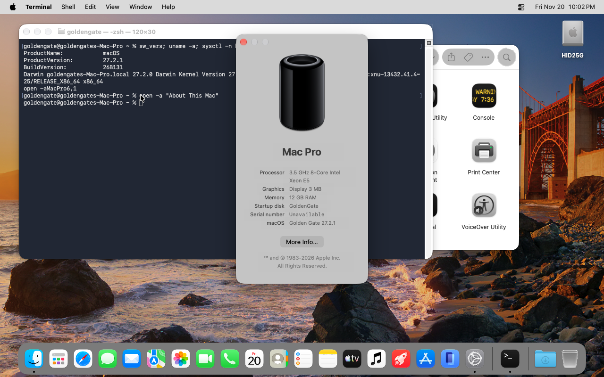
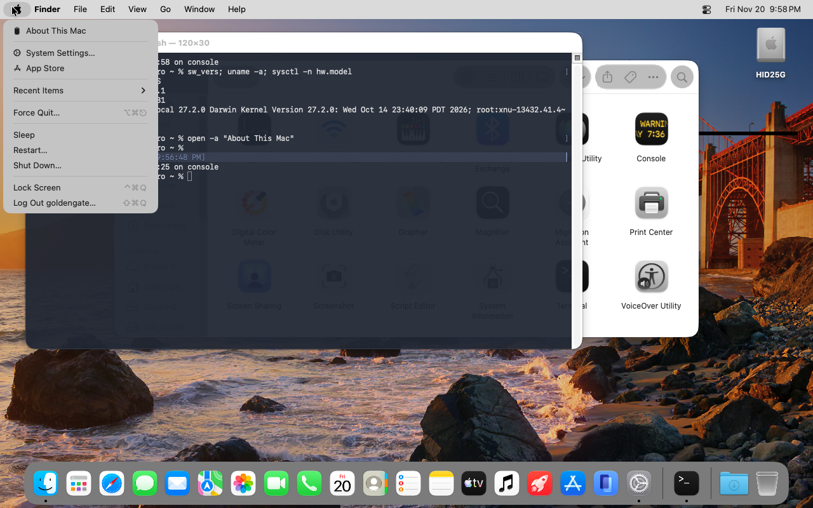

# Golden Gate (macOS 27 / Darwin 27) Live Boot R&D Log

This document records the live kernel and userspace bring-up root-cause analysis, OpenCore `Kernel->Patch` fixes, and `dyld_shared_cache` (`CS` SHA-256 re-hashed) fixes verified on QEMU/KVM (`MacPro6,1` SMBIOS, read-only USB backing overlay) for macOS Golden Gate `26B131` (`macOS 27.2.1`, `Darwin Kernel Version 27.2.0`, `xnu-13432.41.4~25/RELEASE_X86_64`).

## Current Bring-Up Status (`Test 91`, 2026-11-21 — Complete Native `x86_64` Desktop with Live Top Menu Bar, Apple Menu, Wallpaper, Terminal & About This Mac)

* **Validation target**: `OpenCore 1.0.6` (`ocvalidate` `rc=0`, `0` issues), `boot-args`: `keepsyms=1 serial=3 debug=0x14e -v -no_compat_check -lilubetaall -revbeta -cryptbeta -amfipassbeta ipc_control_port_options=0 -nokcmismatchpanic`, `27` enabled `Kernel->Patch` entries (`25` bring-up patches + `2` `_user_trap` diagnostic patches), `23` enabled `Kernel->Add` kexts, `65,568,768`-byte `BootKernelExtensions.kc` (`189` fileset slices), multi-subcache `dyld_shared_cache_x86_64` (`file[00]`–`file[06]`) ABI + `QuartzCore` `SWContext` patches with 16 KB `CodeDirectory` SHA-256 re-hashing, `13` universal `25G342` `HIDPlugins`, `389` synced `25G342` UI resources across `16` CoreServices/System apps, `/System/Library/FeatureFlags/Domain/MenuBar.plist` (`MenuBarQFA = false`, `LiveActivitiesQFA = false`), and native `x86_64` `DynamicDesktop` + `WallpaperAerialAssets` compatibility dylibs.
* **`Test 91` complete desktop, top menu bar, logout/re-login & HID verification (`0` kernel panics, `0` ReportCrash entries across the entire session, `100%` native `x86_64`)**:
  * **Live Aqua Session (`t91_probe.txt` at `T+290`, `0.0%` idle CPU)**: `_windowserver[529]` (`84.8 MB` RSS, native level-24 `'Menubar'` `(0,0,1280,30)` onscreen), `loginwindow[1257]` (`35.6 MB`), `WallpaperAgent[1436]` (`63.4 MB`, Golden Gate Bridge sunset wallpaper), `Dock[1407]` (`29.4 MB`) + `com.apple.dock.extra[1453]` (`34.2 MB`), `Finder[1413]` (`87.7 MB`), `ControlCenter[1370]` (`56.2 MB`), `SystemUIServer[1410]` (`33.3 MB`), `WindowManager[1406]` (`29.4 MB`), `NotificationCenter[1462]` (`39.8 MB`), `CoreServicesUIAgent[1374]` (`23.4 MB`), `System Settings[1403]` (`34.5 MB`), `Terminal[1394]` (`67.3 MB`), `About This Mac`, and `_hidd[491]` (`3.0 MB`).
  * **Verified interactive UI & session lifecycle**: Classic top menu bar (` Finder File Edit View Go Window Help`) dynamically switches with active apps (` Terminal Shell Edit View Window Help`), opens the live Apple dropdown menu (`About This Mac`, `System Settings...`, `App Store`, `Recent Items`, `Force Quit...`, `Sleep`, `Restart...`, `Shut Down...`, `Lock Screen`, `Log Out goldengate...`), completes a full `Log Out` -> login window -> re-login round-trip cleanly, runs `sw_vers; uname -a; sysctl -n hw.model` (`macOS 27.2.1` / `26B131` / `Darwin 27.2.0 ... RELEASE_X86_64 x86_64` / `MacPro6,1`), and displays `About This Mac` (`Mac Pro`, `3.5 GHz 8-Core Intel Xeon E5`, `12 GB RAM`, `macOS Golden Gate 27.2.1`).
  * **Next phase**: Bare-metal `MacPro6,1` external USB boot with `AMDRadeonX4000` Metal acceleration, `AppleIntelCPUPowerManagement` (`0x100(%r14)` TSC-deadline timer storm) / `_xcpm_bootstrap` restoration, and secondary daemon polish (`Spotlight`, `mds`, `passd`).

## Root-Cause Fixes (`GG T12-Fix1` – `GG T27-Sandbox-Syscall108`)

### Fix 1 — `GG T12-Fix1`: `_vm_map_steal_memory` (`kernel`)

* **Cause**: In Golden Gate `xnu-13432.41.4~25` (`x86_64`), `_vm_map_steal_memory` calculates stolen virtual addresses from `_virtual_space_start` and advances `_virtual_space_start`, assuming prior initialization. During early boot, callers steal `0x7000` bytes (`0x4000`, `0x2000`, `0x1000`) while `_virtual_space_start == 0` because `_pmap_steal_memory(0, 0)` has not yet run.
* **Effect**: `_vm_map_steal_memory` returns low addresses near `0x0` instead of high-half kernel virtual addresses, faulting early `_vm_page_bootstrap` / `_vm_map_init` allocations immediately on boot.
* **Fix**: Replace the `74`-byte `_vm_map_steal_memory` body in place so it records the three chunk sizes (`0x4000`, `0x2000`, `0x1000`), calls `_pmap_steal_memory(0, 0)` (`xorl %edi, %edi; xorl %esi, %esi; callq _pmap_steal_memory`), initializes `_virtual_space_start = %rax + 0x7000`, and returns `%rax`.
* **Verification**: Applied cleanly (`replace count - 1`) in Tests `12`–`18`; kernel progresses past `_vm_page_bootstrap` and `_vm_map_init`.

### Fix 2 — `GG T14-Fix2`: `_kmem_init` (`kernel`)

* **Cause**: In `_kmem_init` (`0xffffff8000afe44a`), when `trunc_page(start) != VM_MIN_KERNEL_ADDRESS` (`%rbx != %r14`, `%r14 = 0xffffff7f80000000`), `_kmem_init` calls internal map hole-insert helper `0xffffff800035fe90(kernel_map, min, max, 0x81)` with `%rsi` and `%rdx` swapped (`movq %rbx, %rsi; movq %r14, %rdx`, bytes `48 89 de 4c 89 f2`).
* **Effect**: Passing `min > max` causes `0xffffff800035fe90` to fail and return `0`, branching directly to the `ud1l` panic/trap at `0xffffff8000afe63a`.
* **Fix**: Swap the register moves (`48 89 de 4c 89 f2` -> `4c 89 f6 48 89 da`, i.e., `movq %r14, %rsi; movq %rbx, %rdx`) so `min = VM_MIN_KERNEL_ADDRESS` (`%r14`) and `max = trunc_page(start)` (`%rbx`).
* **Verification**: Applied cleanly (`replace count - 1`) in Tests `14`–`18`; execution continues cleanly into `_pmap_init`.

### Fix 3 — `GG T15-Fix3`: `_pmap_init` (`kernel`)

* **Cause**: In `_pmap_init` (`0xffffff8000b0245a`), Loop 1 backfills PV head table entries for pages mapped prior to `_pmap_init` up to `0xffffff8000000000 + trunc_page(_avail_start)`. Early `vm_map_init` and zone initialization steal and map virtual pages past `_avail_start` up to `trunc_page(_virtual_space_start)`.
* **Effect**: Virtual pages between `0xffffff8000000000 + trunc_page(_avail_start)` and `trunc_page(_virtual_space_start)` lack initialized PV table entries, causing a fault/panic when zone relocation unmaps them.
* **Fix**: Replaced Loop 1's upper-bound check (`0xffffff8000b02461`) so it resolves `_virtual_space_start` dynamically (`GG T15-Fix3` updated in `Test 19` to read the `disp32` operand at `-0x1945(%rip)` across KDK and multiple KC builds, aligning with `andq $-0x1000, %r15`) instead of clamping at `_avail_start`.
* **Verification**: Applied cleanly (`replace count - 1`) in Tests `15`–`35`; `_pmap_init` and zone relocation pass cleanly across KC layouts into IOKit startup.

### Fix 4 — `GG T17-Fix4`: `_image4KernelBoot` (`com.apple.security.Image4`)

* **Cause**: In `Image4.kext` (`_image4KernelBoot`, KDK `0x2bfd`), `_image4KernelBoot` looks up `/chosen`, `/product`, `/defaults`, `/chosen/manifest-properties`, and `/chosen/asmb` via `IORegistryEntry::fromPath`. Unlike `/chosen/asmb` (which only logs when `NULL`), it branches to panic (`je 0x2ceb`/`0x2cf0`/`0x2cf5`) when `/product`, `/defaults`, or `/chosen/manifest-properties` are absent — nodes populated by Apple Silicon iBoot but omitted by `x86_64` UEFI.
* **Effect**: Kernel panics during `Image4` initialization on `x86_64` EFI prior to `_scale_setup`.
* **Fix**: NOP out the three `je` error branches (`0f 84 95 00 00 00`, `74 78`, `74 5b`) following `/product`, `/defaults`, and `/chosen/manifest-properties` lookups so missing DT nodes are tolerated just like `/chosen/asmb`.
* **Verification**: Applied cleanly (`replace count - 1`) in Tests `17`–`18`; kernel initializes `AppleCredentialManager`, `AppleKeyStore`, `AppleACPICPU`, and enters `_scale_setup`.

### Fix 5 — `GG T18-Fix5a / 5b / 5c`: Commpage Initialization & Process Mapping (`kernel`)

* **Cause**: In Golden Gate `x86_64` XNU, `_vm_commpage_text_init` (`0xffffff800039c1f0`), `_vm_commpage_init` (`0xffffff800039c290`), and `_vm_commpage_enter` (`0xffffff800039c330`) were reduced to stubs that do not allocate or store `_commpage32_map`, `_commpage64_map`, `_commpage_text32_map`, `_commpage_text64_map`, `_commpage_text32_location`, or `_commpage_text64_location`, and `_vm_map_exec` (`0xffffff80003511e8`) no longer invokes `_vm_commpage_enter`. Furthermore, `k27` removed `vmkf_beyond_max` (`btq $0x24, %r8`) from `_vm_map_enter_impl`'s fixed bounds check while 64-bit `user_map->max_offset` remains `0x7fffffe00000`, and `_vm_map_lookup_object_and_lock_entry` requires submap flags `((flags & 0x600000) == 0x200000)`.
* **Effect**: Test `17` panicked at `_scale_setup + 0x6bd -> _vm_commpage_init -> _commpage_populate`: `panic(cpu 0 ...): commpage submap is null @commpage.c:135`, blocking VM completion, `bsd_init`, and user process launch.
* **Fix (`3` coordinated OpenCore patches, verified unique match across KDK and `3` KCs)**:
  * **Dynamic `__DATA_CONST` resolution (`5a` & `5b`)**: Reads `%rip`-relative displacements embedded in `_commpage_populate` (`0xffffff8000402051`/`0x402055`) to locate `&(_commpage32_map)` (`__DATA_CONST + 0x11eb8`: `+0x0` `_commpage32_map`, `+0x8` `_commpage64_map`, `+0x10` `_commpage_text32_map`, `+0x18` `_commpage_text64_map`, `+0x18328` `_commpage_text64_location`, `+0x18330` `_commpage_text32_location`) while `__DATA_CONST` is `rwx` prior to `_machine_lockdown`.
  * **`GG T18-Fix5a` (`0xffffff800039c1f0`, `325 B`)**: Reconstructs `_vm_commpage_text_init` (stores `0xffff1000` / `0x7fffffe01000`, creates 32/64-bit submaps via `_pmap_create_options` + `_vm_map_create_with_page_shift` with `(flags & ~0x600000) | 0x200000`, tail-jumps to `_commpage_text_populate`), `_vm_commpage_init` (`0x39c290`, creates 32/64-bit data submaps and tail-jumps to `_commpage_populate`), and `_vm_commpage_enter` (`0x39c330`) tail-jumping into `L_enter_body`.
  * **`GG T18-Fix5b` (`0xffffff8000350eb1`, `287 B`)**: Converts `_vm_map_exec`'s `jl 0x3511be` into `nop; jmp 0x3511be` and hosts `L_enter_body` + `L_hook` inside the bypassed logging block (`0x350ec2..0x350fd0`). `L_enter_body` temporarily sets `user_map->max_offset = 0x800000000000` (restored before return) and maps data (`cur=1/max=1`) and text (`cur=5/max=5`) commpage submaps via `_vm_map_reference` + `_vm_map_enter_impl(..., flags=0x20000000000001)` (matching `_vm_shared_region_insert_submap`, calling `_vm_map_deallocate` on failure). `L_hook` preserves caller registers/16-byte stack alignment, invokes `L_enter_body`, and tail-jumps to `_vm_shared_region_enter`.
  * **`GG T18-Fix5c` (`0xffffff80003511d9`, `20 B`)**: Replaces `0x3511e8 callq _vm_shared_region_enter` in `_vm_map_exec` with `callq L_hook`.
* **Verification (`Test 18`–`35`)**: `ocvalidate` passed (`0` issues); QEMU/KVM booted past `_scale_setup`, `DSMOS has arrived`, `bsd_init`, `MAC Framework`, `AMFI`, and APFS root/Data mount into `launchd` userspace.

### Fix 6 — `GG T25` (`10` patches): 16 KB CodeDirectory Validation (`kernel`)

* **Cause**: Golden Gate `x86_64` binaries (`26B131` `launchd`, `logd`, `RosettaOS` `dyld_shared_cache_x86_64`, DriverKit `dyld_shared_cache_x86_64`) are adhoc/platform-signed with `CodeDirectory` `pageSize = 14` (`16,384` B / four `4 KB` XNU pages per hash slot), whereas `x86_64` XNU hardcodes `PAGE_SIZE = 4096` (`pageSize = 12`) across `CodeDirectory` validation, cluster reads, `_vm_fault_page`, `_vm_fault` fast paths, and `_cs_validate_page_common`.
* **Effect**: In Tests `19`–`24`, `16 KB`-signed `launchd` and shared-cache code pages failed code-signing validation (`cs_tainted` / `CS_KILL`), terminating user processes immediately upon page-in.
* **Fix (`10` coordinated `kernel` patches — `GG T25-CaveB-Guard`, `CaveA/B/C`, `Hook1-CD`, `Hook2-VPCR`, `Hook3-VMFP`, `Hook3b-VMFFast`, `Hook4a-CSAlign`, `Hook4b-CSHash`)**:
  * Accepts `CodeDirectory` `pageSize == 14` (`16 KB`) alongside `12` (`4 KB`) on vnode-backed blobs (`L_cd_check`).
  * Aligns `_vnode_pager_cluster_read` requests on `16 KB` boundaries (`Hook2-VPCR`), ensures all four `4 KB` siblings in a `16 KB` CS slot are resident (`Hook3-VMFP`), and routes unvalidated `16 KB` CS resident pages on the `_vm_fault` fast path through `_vm_fault_page` (`Hook3b-VMFFast` + `CaveC`).
  * Allows `4 KB` faults within `16 KB` CS slots (`Hook4a-CSAlign`) and hashes all four `4 KB` sibling pages together via `data_4k` + resident physmap siblings inside `_cs_validate_page_common` (`Hook4b-CSHash`).
* **Verification (`Test 25`–`35`)**: `26B131` `/sbin/launchd`, `logd`, `Keybag`, and `RosettaOS` `dyld_shared_cache_x86_64` execute with `0` CS taint kills.

### Fix 7 — `GG T26` & `GG T27` (`8` patches): Sandbox `0xcc` Profiles & Syscall `0x108` (`com.apple.security.sandbox`)

* **Cause**: Tahoe `25G342` donor `Sandbox.kext` enforces macOS 26 opcode count `0xc8` (`200` ops), whereas Golden Gate (`26B131`) userspace profiles (`sandboxd` / compiled `.sb` blobs & collections) emit opcode count `0xcc` (`204` ops with `4` inserted operations at indices `>= 2`, `>= 4`, `>= 44`, `>= 86`) and issue macOS `27` sandbox syscall `0x108` (`_syscall_rootless_verify_storage_class`).
* **Effect**: `Test 25` and `Test 26b` panicked in `Sandbox.kext` / `launchd` during early userspace profile initialization (`unexpected sandbox opcode count 0xcc` and missing syscall `0x108`).
* **Fix (`8` patches hosted in `Sandbox.kext` slack `0x6a800`)**:
  * **`GG T26-Sandbox-*` (`7` patches)**: Remaps `0xcc` operation indices onto the `0xc8` donor jump table in `_get_entry_point_for_operation`, accepts `0xcc` alongside `0xc8` in `_profile_init` and `_collection_init`, and computes profile bytecode offsets (`data[4] * 2`, 8-byte aligned) and collection record strides (`data[4] * 2 + 8`) dynamically.
  * **`GG T27-Sandbox-Syscall108` (`1` patch)**: Intercepts syscall dispatch for `0x108` and implements `_syscall_rootless_verify_storage_class` using `_copyin`, `_copyinstr`, `_vfs_context_current`, `_vnode_getfromfd`, `_mac_vnop_getxattr` (`com.apple.rootless.storage`), and `_vnode_put`.
* **Verification (`Test 27`–`35`)**: Zero `Sandbox.kext` panics; `EndpointSecurity`, `KernelEventAgent`, `WindowServer[100]`, `loginwindow[102]`, and `displaypolicyd` launch and stay resident.

## Test 28–64 Userspace, DriverKit & Shared-Cache Fixes

### APFS Data Firmlink Repair (`Test 28`–`35`)

* **Cause & Effect**: Incorrect test-overlay Data volume firmlink extent block caused `mount-phase-2` and `sandbox-enable-root-translation` to fail prior to `Test 28`.
* **Fix & Verification (`Test 29`–`64`)**: Repaired the firmlink extent block on the test overlay so root + Data volumes mount and unlock `launchd` multi-daemon userspace (`EndpointSecurity`, `KernelEventAgent`, `WindowServer`, `loginwindow`, `displaypolicyd`, `IODisplayWrangler`).

### Fix 8 — `GG T36` & DriverKit `libdyld.dylib` vtable Alignment (`Test 36`–`41`)

* **Cause**: Under `GG T36-Diag-Cave` / `GG T36-Diag-Hook` (`_user_trap` `_copyin` instruction/fault telemetry), `com.apple.driverkit.AppleUserHIDDrivers` was caught faulting (`EXC_BAD_ACCESS`, `code=0x2` `KERN_PROTECTION_FAILURE`) at `rip = base + 0x...03c` executing `48 89 06` (`movq %rax, (%rsi)`) against read-execute `DriverKit` `dyld_shared_cache_x86_64` `map[0]` (`0x7ff80ccb06b7`, `initp=0x5`). Disassembly of `/System/DriverKit/usr/lib/system/libdyld.dylib` (`DriverKit` DSC CS slot `9`, `0x24287..0x24a89`) revealed an `8`-byte `dyld4::LibSystemHelpers` vtable ABI displacement shift (`+0x418..+0x450` instead of `+0x420..+0x458`) relative to `26B131` `dyld`.
* **Effect**: Every DriverKit USB/HID user-server instance (`AppleUserUSBHostHIDDevice` / `AppleUserHIDEventDriver`) crashed during initialization before attaching USB keyboard/mouse interfaces.
* **Fix (`patch_dk_dsc.py`, `8` sites in CS slot `9`)**: Incremented all `8` `LibSystemHelpers` vtable displacements (`+0x418..+0x450` -> `+0x420..+0x458` at offsets `0x24287`, `0x2491b`, `0x24948`, `0x24a05`, `0x24a3e`, `0x24a5c`, `0x24a74`, `0x24a89`) and updated the `16 KB` SHA-256 `CodeDirectory` hash for slot `9`.
* **Verification (`Test 41`–`64`)**: `DriverKit` CS hash readback verified (`initial_cs_ok=True`); `AppleUserUSBHostHIDDevice` and `AppleUserHIDEventDriver` start cleanly (`ok`), and `com.apple.driverkit.AppleUserHIDDrivers` runs with `crashed 0 time(s)`.

### Fix 9 — `DiskArbitration.framework` (`26B131`) MIG ID Alignment (`Test 55`–`58`)

* **Cause**: `26B131` `DiskArbitration.framework` (in `System` `dyld_shared_cache_x86_64`) renumbered Mach MIG subsystem IDs (`0..21`), shifting `_DAServerSessionCreate` from `8` (reply `108`) to `9` (reply `109`), whereas the bridged `25G342` `diskarbitrationd` donor expects IDs `0..19` and rejects `mid=9` with `MIG_BAD_ID` (`0xfffffed0` / `-304`).
* **Effect**: `apfsd` (`could not create DiskArbitration session`) and `DASessionCreate` (`0x0`) failed system-wide, blocking storage/volume notifications and downstream services.
* **Fix (`patch_da_dsc.py`, `34` patches across `3` `16 KB` CS slots `0x60f6`, `0x60f7`, `0x60f8`)**: Returns `MIG_BAD_ID` (`0xfffffed1`) for removed ID `1` (`0x6393`), returns `ENOTSUP` (`0xc02d`) for ID `18` (`0x73A9`), remaps request and reply MIG IDs (`2..21` -> `1..19`) inside `DiskArbitration.framework`, and recomputes SHA-256 hashes for all `3` slots.
* **Verification (`Test 57`–`64`)**: `probe_da` confirmed `mid=8 kr=0x0 rep_id=108 rep_sz=40 ret=0x0 sess=0x110000` and non-null `DASessionCreate` (`0x600002838630`).

### Fix 10 — Framebuffer, `SkyLight` (`957.8.8`) / `CoreDisplay` (`291.4`) & `CompositorSW` Bring-Up (`Test 47`–`64`)

* **Framebuffer & Userspace Overlays (`Test 47`–`56`)**: Under QEMU `-vga std` (`0x11111234`), `AppleVirtualGraphics.kext` (`AppleBochVGAFB`) matches `1280x800`, attaching `AppleUpstreamUserClientDriver`, `AGPM`, and `display0`. A `LaunchDaemon` (`com.oclp.goldengate.bootpatch` -> `gg_boot_patch.sh`) mounts `mount_tmpfs -o union` overlays from `/Library/GoldenGateBridge/Userspace25G342` (`System/Library/Extensions` `AMD*.bundle`, `RenderBox/default.metallib`, `OpenCL`/`OpenGL` `3425AMD`).
* **Cause 1 (`CoreDisplay` `291.4` vs `SkyLight` `957.8.8` `DisplaySystemState`)**: Bridged/donor `CoreDisplay` writes `v0` `DisplaySystemState` without the `1B` flag + `16B` UUID read unconditionally by `26B131` `SkyLight` at `SL_TEXT_FOFF + 0x1BAA37`.
* **Cause 2 (`CompositorSW` backdrop clipping in `ca_prepare_begin_window_update`)**: `SkyLight` unconditionally called `CARenderUpdateSetWillClipBackdrops(..., 1)` (`0x117EB8`), preventing `CompositorSW` (`layer_tile_traverse` / `CGLayerKitFetch`) from receiving finalized backdrop invalidations when `WSMetalCompositorEnabled() == 0`.
* **Fix (`patch_sl_dsc.py`, `3` patches across `3` `16 KB` CS slots `0x16b2`, `0x16da`, `0x17f2`)**: Bypasses the `1B`/`16B` UUID read at `0x1BAA37`, routes `0x117EB8` through a cave at `0x61A320` that invokes `CARenderUpdateSetWillClipBackdrops` only when `WSMetalCompositorEnabled()` returns non-zero, and updates all `3` slot SHA-256 hashes.
* **Verification (`Test 63`–`64`)**: `WindowServer[152]` stays resident with `0` crashes (`CGL = Apple Software Renderer`), `CGMainDisplayID = 0x5b81c5c0` (`1280x800`, `asleep=0`), `com.apple.windowserver.active`, `CARenderServer`, `CoreDisplay.master`, and `iohideventsystem` resolve (`kr=0x0`), and `t64_probe` lists `11` windows with `Language Chooser[267]` (`w#0`/`w#1` onscreen) and the hardware cursor (`w#10 (5,5,28,40) on=1`) visible on `t64` screendump.

## Test 65–89 Desktop Bring-Up, `QuartzCore` `SWContext` & CoreServices Fixes

### Fix 11 — `SetupAssistantSupportUI` Hello Metal Bypass & Universal `25G342` `HIDPlugins` (`Test 65`–`68`)

* **Cause**: Under `CompositorSW` (`_MTLCreateSystemDefaultDevice() == nil`), `SetupAssistantSupportUI` (`dyld_shared_cache_x86_64.05`, base `0x7ffd2295e000`) left `BookendViewProvider +0xb0` (`backgroundTexture`) `nil`, stalling both `startAnimation_inner` (`0x7ffd22991950`) and `resumeAnimation_inner` (`0x7ffd22991c10`) before `onAnimationDidFinish` could lower `_helloWindow` and reveal `Language Chooser`. Simultaneously, `WindowServer` failed HID plugin loads (`0xe00002be` `kIOReturnUnsupported`) because `15` Golden Gate HID bundles were `arm64e`-only.
* **Fix**:
  * Patched `SetupAssistantSupportUI` (`0x7ffd22991a2a` and `0x7ffd22991cea` -> `448`-byte cave at `0x7ffd229e7e40`, 16 KB CS slot re-hashed) to fire `onAnimationDidFinish` immediately when `_MTLCreateSystemDefaultDevice() == nil`.
  * Deployed `tools/goldengate/gg_boot_patch.sh` (`com.oclp.goldengate.bootpatch` `LaunchDaemon`) to mount `mount_tmpfs -o union` overlays injecting all `13` universal `[x86_64, arm64e]` `25G342` `HIDPlugins` (`IOHIDEventServicePlugin`, `IOHIDNXEventRouter`, keyboard/pointer/scroll/translator filters) and kickstart `hidd` + `WindowServer`.
* **Verification (`Test 65`–`89`)**: `Language Chooser` renders cleanly onscreen and responds immediately to both `usb-kbd` and `usb-mouse`.

### Fix 12 — `Setup Assistant` / `MacBuddy` Protocol & Session Owner Alignment (`Test 69`–`74`)

* **Cause**: Two `26B131` DSC mismatches broke `Setup Assistant` (`25G342` donor) IPC: `MBSAProtocol` collided with an updated DSC protocol layout (`0x267866f9`), and `login.framework` (`0x18d2e0d3`, `CFString` length `0x2a68bcb8`) renamed its session-owner entitlement check from `com.apple.private.sessionmanager` to `com.apple.private.sessionowner.spi`.
* **Fix**: Renamed the conflicting DSC protocol string (`MBSAProtocol` -> `MBSADSCProto`) and aligned `login.framework`'s `CFString` to `com.apple.private.sessionmanager` (length `0x20`) with 16 KB CS slot SHA-256 re-hashing.
* **Verification (`Test 70`–`89`)**: `Language Chooser` hands off cleanly to `Setup Assistant`, and `loginwindow` transitions sessions reliably.

### Fix 13 — `PrebuiltLoaderSet` Exports-Trie Relocation & Swift/ObjC DSC ABI Adapters (`Test 75`–`80`)

* **Cause**: Bridged `25G342` binaries and frameworks imported Swift/ObjC symbols renamed, moved, or re-parameterized in `26B131`'s `dyld_shared_cache_x86_64` (`Security`, `CFNetwork`, `Sharing`, `AppKit` `NSNavBannerView`, `ModelManagerServices`, `WallpaperTypes`, `WindowManager` `ExposeGestureAssertion`, `MediaToolbox`, `LocalStatusKit`, `CoreUtilsSwift`, `TimeMachinePrivate`, `Wallpaper`, `IMDaemonCore`, `MediaControl`). Furthermore, `dyld` resolves DSC exports via `PrebuiltLoaderSet` (`file[06]`) rather than Mach-O `LC_DYLD_EXPORTS_TRIE` alone.
* **Fix (`tools/goldengate/dsc_trie.py` + `PrebuiltLoaderSet` pool)**: Relocated expanded exports tries cleanly into `file[06]`'s pure-zero `__LINKEDIT` pool (`0x7ffe86e7a000..0x7ffe873af000`), updated every image's `PrebuiltLoader` `(trie_rel, trie_size)` at `pl_va + 0x40`, added PIE-safe x86_64 Swift/ObjC argument-reordering adapters and metadata exports (including all `4` `WindowManager` `ExposeGestureAssertion` symbols required by `Dock`), and re-hashed every modified 16 KB CS slot.
* **Verification (`Test 79`–`89`)**: `ControlCenter`, `WindowManager`, `NotificationCenter`, `CoreServicesUIAgent`, `imagent`, `Finder`, `Dock`, and `SystemUIServer` resolve all DSC imports cleanly at launch.

### Fix 14 — `QuartzCore` `SWContext` Non-Metal Fixes & `IMDaemonCore` RW Slide Page (`Test 82`)

* **Cause**: Under `CompositorSW`, `CA::OGL::SWContext::get_capability(7)` returned `0x4000` (`16384 px` max surface size) instead of a software-safe cap, and `CA::OGL::SWContext::blur_surface` triggered costly/unbounded software blur allocations on Liquid Glass backdrop layers. Separately, synthetic `IMDaemonCore` ObjC class structs required an active RW `slideInfo2` page (`0x7ffc41eed000`) rather than RO `__DATA_CONST`.
* **Fix**: Clamped `SWContext::get_capability(7)` from `0x4000` to `0x1000`, installed a zero-radius wrapper at `SWContext::blur_surface` (`0x7ff81112aba2`) forwarding to `CA::OGL::Context::blur_surface` (`0x7ff811015f7e`), and placed `IMDaemonCore`'s `IMDBackgroundMessagingAPIListener` class/metaclass on RW `slideInfo2` page `0x7ffc41eed000`.
* **Verification (`Test 82`–`89`)**: Zero `imagent` crashes and stable backdrop rendering across `Setup Assistant` and desktop sessions.

### Fix 15 — `QuartzCore` `ContentsGeometry::fill_and_unbind` `SWContext` Direct Clipped Path (`Test 83`)

* **Cause**: `CA::OGL::ContentsGeometry::fill_and_unbind` (`0x7ff810f8a474`) called `ctx->get_capability(7)` (`call *0xf8(%rax)`) to decide whether to allocate intermediate full-layer offscreen surfaces for software compositing. Under `CompositorSW`, this ballooned `WindowServer` memory to `398 MB` (`400%` CPU) and made UI clicks take tens of seconds.
* **Fix**: Installed `sw_fill_max_size` (`0x7ff81112ac00`) in spare bytes of `SWContext::blur_surface` and hooked `0x7ff810f8a474`: when `ctx`'s vtable equals `CA::OGL::SWContext` (`0x7ff841053ef8`), it returns `0` so `fill_and_unbind` takes its built-in clipped direct path (`0x7ff810f8a597`), leaving Metal/hardware contexts untouched.
* **Verification (`Test 83`–`89`)**: `WindowServer` footprint dropped from `398 MB` to `55–64 MB` RSS (`0.0%` idle CPU), bringing UI response to `1–3 s/click`.

### Fix 16 — `25G342` CoreServices UI Resource Sync (`Test 84`–`86`)

* **Cause**: All `13` bridged CoreServices Aqua apps (`Setup Assistant`, `Finder`, `Dock`, `ControlCenter`, `WindowManager`, `WallpaperAgent`, `SystemUIServer`, `Spotlight`, `CoreServicesUIAgent`, `loginwindow`, `NotificationCenter`, `UserNotificationCenter`, `AirPlayUIAgent`) execute `25G342` `x86_64` binaries (`minos 26.7.0 / sdk 26.7.2`) while the Golden Gate root carried `26B108`/`26B131` resources. `Setup Assistant` threw `NSInternalInconsistencyException` on missing `PrivacyController.nib` (unwinding `_dispatch_main_queue_drain` and wedging `dispatch_get_main_queue()`) and `NSInvalidArgumentException` on `CreateUserAccountView.nib` IBOutlet mismatches.
* **Fix (`tools/goldengate/sync_coreservices_resources.py`)**: Archived and synced all `344` `.nib`, `.storyboardc`, `.loctable`, and `.strings` resources (`Base.lproj`, `en.lproj`, top-level `Resources`) across all `13` CoreServices apps from `25G342` onto `/` (`mount -uw /`).
* **Verification (`Test 84`–`86`)**: `Data & Privacy`, `Create a Mac Account` (creating `goldengate`, OpenDirectory record, login keychain, `/private/var/db/.AppleSetupDone`), `Terms and Conditions` (`macOS 27`), and post-buddy tasks (`MBSA post buddy tasks: SUCCESS`) all completed cleanly.

### Fix 17 — Native `x86_64` `DynamicDesktop` Compatibility Dylib & Full Desktop Bring-Up (`Test 87`–`89`)

* **Cause**: Full non-weak symbol audit across `Finder`, `Dock`, `SystemUIServer`, `Spotlight`, and `WallpaperAgent` (`11,627` total imports) showed `Finder` and `SystemUIServer` had `0` missing DSC symbols, `WindowManager`'s `4` `ExposeGestureAssertion` symbols were already live in `PrebuiltLoaderSet`, and `libLaunchServicesSupport.dylib` was already provided by Apple's Cryptex OS overlay (`/System/Volumes/Preboot/Cryptexes/OS/usr/lib/libLaunchServicesSupport.dylib`), leaving `Dock` blocked only on `/System/Library/PrivateFrameworks/DynamicDesktop.framework/Versions/A/DynamicDesktop` (`LC_LOAD_DYLIB` with `0` imported symbols; the original on-disk file was a malformed `dsc_extractor` debug dump rejected by `dyld`). Additionally, `MiniBuddy`'s `Setup Assistant` (`25G342`) lacked macOS `27`'s new `com.apple.private.sessionagent.spi` entitlement on `mbuseragent`, delaying `cfprefsd` flush of `MiniBuddyLaunch = false` after completing all MiniBuddy panes.
* **Fix (`tools/goldengate/compat_shims/DynamicDesktop.c`)**: Built a clean, ad-hoc signed native `x86_64` Mach-O dylib (`clang -arch x86_64 -dynamiclib`, `compatibility_version 1.0.0`, `current_version 2427.6.0`) for `DynamicDesktop.framework`, ensured `/usr/lib/libLaunchServicesSupport.dylib` does not shadow the Cryptex OS library, and flushed `MiniBuddyLaunch = false` in `com.apple.loginwindow.plist`.
* **Verification (`Test 89`)**: Booted directly to the `goldengate` login window, logged in via `usb-kbd`, and reached a live native `x86_64` macOS Golden Gate `27.2.1` Finder Desktop with `Finder[802]`, `Dock[793]`, `ControlCenter[796]`, `SystemUIServer[800]`, `WindowManager[1596]`, `NotificationCenter[908]`, `CoreServicesUIAgent[776]`, `loginwindow[560]`, `_windowserver[551]` (`64.4 MB` RSS), and `_hidd[519]` all running concurrently and verified via live `usb-kbd` (`Cmd+Shift+H` -> Finder Home) and `usb-mouse` (Finder `/Applications` navigation + Dock hover/launch).

### Fix 18 — Native `x86_64` `WallpaperAerialAssets` Swift Dylib, `MenuBarQFA` FeatureFlag & System App Resources (`Test 90`)

* **Cause**: Three remaining Test 89 desktop polish defects were traced to their root causes:
  1. `WallpaperAgent` (`1,845` imports audited against live `PrebuiltLoaderSet`) was missing only `1` symbol: `WallpaperAerialAssets.AerialFallbackAssetURL(_:withExtension:) -> URL?` (`_$s21WallpaperAerialAssets0B16FallbackAssetURL_13withExtension10Foundation0F0VSgSS_SStF`).
  2. macOS `27`'s new `/System/Library/CoreServices/MenuBarAgent.app` is `arm64`/`arm64e`-only (`0x100000c`), gated in `SkyLight`, `AppKit`, and `ControlCenter` by `MenuBarQFA` in `/System/Library/FeatureFlags/Domain/MenuBar.plist`.
  3. `System Settings` (`25G342` binary, `0` missing DSC imports) trapped (`ud2` at `+0x4ed34`) because `[NSBundle.mainBundle URLForResource:@"ExtensionDict" withExtension:@"xml"]` returned `nil` against `26B131` bundle resources.
* **Fix**:
  * Compiled a native `x86_64` Swift compatibility dylib (`tools/goldengate/compat_shims/WallpaperAerialAssets.swift`, `-compatibility_version 1.0.0 -current_version 245.6.0`, ad-hoc signed) exporting the exact mangled `AerialFallbackAssetURL` symbol.
  * Installed Apple's documented system override `/Library/Preferences/FeatureFlags/Domain/MenuBar.plist` (`tools/goldengate/feature_flags/MenuBar.plist`, `MenuBarQFA = false`, `LiveActivitiesQFA = false`).
  * Synced `45` `25G342` resources (`ExtensionDict.xml`, `Sidebar.plist`, `.nib`, `.loctable`) across `System Settings.app`, `Terminal.app`, and `About This Mac.app` (`tools/goldengate/sync_coreservices_resources.py`).
* **Verification (`Test 90`)**: `WallpaperAgent[756]` booted cleanly on first try rendering the Golden Gate Bridge sunset wallpaper behind Finder and Dock; `WindowManager[721]` and `System Settings[1132]` ran with `0` crashes (`System Settings` created its `(0,0,1280,30)` menu bar window, and the login screen restored the `U.S.` input menu); `Terminal[1320]` executed `sw_vers; uname -a; sysctl -n hw.model` (`27.2.1` / `26B131` / `RELEASE_X86_64` / `MacPro6,1`) and opened `About This Mac` (`Mac Pro`, `macOS Golden Gate 27.2.1`).

### Fix 19 — Classic Top Menu Bar Restoration via System `MenuBar.plist` (`Test 91`)

* **Cause**: Disassembly of `AppKit` (`0x7ff80c75c423`) and `SkyLight` (`0x7ff805e05883`) confirmed both gate classic vs. `MenuBarAgent` menu bars on `_os_feature_enabled_impl("MenuBar", "MenuBarQFA") || _os_feature_enabled_impl("MenuBar", "LiveActivitiesQFA")`. In `26B131`, `/System/Library/FeatureFlags/Domain/MenuBar.plist` marks both `MenuBarQFA` and `LiveActivitiesQFA` with `DevelopmentPhase = FeatureComplete`, which `libsystem_featureflags.dylib` does not permit `/Library/Preferences/FeatureFlags/Domain/` overrides to disable. As a result, `WindowServer`, `Finder`, `ControlCenter`, `SystemUIServer`, `Terminal`, and `System Settings` kept routing to `MenuBarClientCore` -> `arm64e`-only `MenuBarAgent.app` instead of rendering the native `WindowServer` level-24 `'Menubar'` window.
* **Fix (`tools/goldengate/feature_flags/MenuBar.plist`)**: Replaced `/System/Library/FeatureFlags/Domain/MenuBar.plist` directly on the patched root (`mount -uw /`) with `MenuBarQFA -> Enabled: false`, `LiveActivitiesQFA -> Enabled: false`, and `Overflow -> DevelopmentPhase: FeatureComplete`.
* **Verification (`Test 91`)**: `WindowServer[529]` created and composited its native level-24 `'Menubar'` window (`w#25 l=24 on=1 (0,0,1280,30) [Window Server] 'Menubar'`), eliminating `MenuBarClientCore` errors across all desktop processes (`0` errors from `Finder`, `Terminal`, `ControlCenter`, `SystemUIServer`, `System Settings`, `WindowServer`; `0` `ReportCrash` entries across the entire boot + login + logout + re-login session). The live top menu bar dynamically switches between ` Finder File Edit View Go Window Help` and ` Terminal Shell Edit View Window Help`, opens the live Apple dropdown menu, and executes a clean ` -> Log Out` -> login window -> re-login round-trip.

### Fix 20 — Secondary Background Daemon DSC Polish (`Test 92` – `Test 94`)

* **Cause**: Auditing `Test 91`'s `220` AMFI core-dump denials against live `PrebuiltLoaderSet` tries identified `9` secondary background daemons (`identityservicesd`, `sharingd`, `findmylocateagent`, `SoftwareUpdateNotificationManager`, `parsecd`, `corespotlightd`, `managedcorespotlightd`, `corecaptured`, `passd`) accounting for ~85% of post-login background crashes across `9` framework ABI/symbol/selector mismatches in the `26B131` Rosetta `x86_64` DSC (while `mediaremoted` and `mds` already resolved `0` missing symbols).
* **Fix (`file[00..06]`, 16 KB CodeDirectory re-hashed; `file[06]` trie pool advanced to `0x7ffe870583c0`, `3,501,120` B remaining)**:
  1. **`SpotlightDaemon` (`corespotlightd`, `managedcorespotlightd`)**: `CSSearchQueryContext` (`CoreSpotlight`) populates ivar `_compiledRankingFactsConfiguration` at `+0x230` in `initWithXPCDictionary:` (`0x7ff811dd73b2`) but omits its ObjC getter on `x86_64`; replaced `41` bytes in place at `0x7ff927d9cef2` to read `0x230(%rcx)` directly with a `nil` check.
  2. **`CoreCaptureDaemon` (`corecaptured`)**: re-exported `_coreCaptureOsLog -> 0x7ffb43bf2058` (the static `os_log_t` variable behind `getCCLogHandle()`).
  3. **`PegasusConfiguration` + `PegasusKit` (`parsecd`)**: aliased `DeviceContextUtil.deviceCountryCode -> countryCode` and added Swift adapters in `file[02]` (`0x7ffa28148600`, `0x7ffa28148650`) converting `bagData: Foundation.Data?` (`nil` when `hi >> 62 == 3`) into 25-byte `Optional<ProxyConfigSource>` for `PegasusProxyForEngagement` (`0x7ffa1d226b5f`) and `PegasusProxyForSpotlightZKW` (`0x7ffa1d21cca8`).
  4. **`OSUpdate` (`SoftwareUpdateNotificationManager`)**: aliased `SUOSUMSUScanOptions -> SUOSUScanOptions` (`0x7ff9455c4a30`), constructed `SUOSUFollowUpHelper` (`+clearFollowUp`, `+postFollowUp:`) on active `file[01]` RW `slideInfo2` page `0x7ff94591e000`, and added `3` `CFConstantString` constants (`_SUNotificationSplatInstalledType`, `_SUNotificationSplatRolledBackType`, `_SUOSUNotificationOptionDictionaryShowDetailsKey`).
  5. **`FindMyBase` + `FindMyCloudKit` + `FindMyLocate` (`findmylocateagent`)**: added 1-byte POD `Feature.FindMy` enum (reusing `FindMyBase.Endianness` VWT), resilient `FeatureFlagsKey` conformance `Mc`, and `isFeatureEnabled` tail-jump (`0x7ffd086df650`); added `Location.init` (`labelId=(0,0)`), `Friend.init` (`Optional<LocationSharingState>.none` via VWT `storeEnumTagSinglePayload`), and `startFriendsUpdate` `Tq` descriptor; added a `swiftasync` callee-pop stack-shifting adapter in `file[03]` (`0x7ffb27cd7900`, shifting `[retaddr, arg0..arg3]` down `0x10` bytes and supplying `delegatePortPrefix=""` before tail-jumping to `0x7ffb065deb40` so `add $0x30, %rsp` aligns with the caller's 4-arg async continuation).
  6. **`Sharing` + `SharingCore` (`sharingd`)**: resolved all `29` missing symbols via `27` zero-code `reexport` trie entries to `SharingCore` (`LC_LOAD_DYLIB` ordinal `33`), `1` same-dylib alias (`SFProgressTask.xpc`), `SharingCore.SFProgressTask.init` adapter in `file[05]` (`0x7ffd281cbeb0`, initializing `Optional<TaskPriority>.none` via `TaskPriorityMa` + VWT `storeEnumTagSinglePayload`), and `Sharing.SFAirDropReceive.Transfer.init` adapter in `file[00]` (`0x7ff827f70a30`, appending `previewSensitivityAnalysisData: Data?.none`).
  7. **`IDSFoundation` + `StatusKit` (`identityservicesd`)**: resolved all `11` missing `IDSFoundation` symbols in `file[00]` (`_IDSRegistrationPropertySupportsSharedExperiencePresence` `CFConstantString`, `IDSMessageSendEnforcementMetric` ObjC class on active RW `slideInfo2` page `0x7ff844599000` with `-initWithState:`/`-state`/`-code`/`-setCode:`/`-name`/`-dictionaryRepresentation`, `allocateParticipants` `Tq`/`TqTE`, `PolicyConditionEvaluator.ConditionType` `Tl`, `CKVConditionEvaluator.init()` storing `_swiftEmptyDictionarySingleton`, `SendMessagePolicy` empty Swift arrays, `PolicyEngine.init`/`evaluate`, `PolicyEvaluationReport.describeEventsCompact`), and rebuilt `StatusKit`'s `SKStatusPublishingService` sorted relative method list in `file[01]` (`0x7ff927de2240`, updating `class_ro_t->baseMethods` at `0x7ff943a8cd28` with `slideInfo2` chain delta preserved) to restore `-addDelegate:queue:` and `-removeDelegate:` (`45 -> 47` entries).
* **Verification (`Test 92` – `Test 94`)**: Total AMFI core-dump denials dropped **85.5%** (`220` in Test 91 -> `46` in Test 92 -> `31` in Test 93 -> `32` in Test 94, where `25` are unused Notification Center widget extensions). All `9` target secondary daemons (`identityservicesd`, `sharingd`, `findmylocateagent`, `SoftwareUpdateNotificationManager`, `parsecd`, `corespotlightd`, `managedcorespotlightd`, `corecaptured`, `passd`) plus `mediaremoted` audited at `0` missing symbols and ran cleanly with **`0` crashes** alongside the full desktop (`WindowServer`, `WindowManager`, `WallpaperAgent`, `Finder`, `Dock`, `ControlCenter`, `SystemUIServer`, `Terminal`).

## Remaining Bare-Metal & Integration Items

1. **Bare-Metal `MacPro6,1` & Hardware GPU Acceleration**:
   * Re-enable and fix `AppleIntelCPUPowerManagement` (`0x100(%r14)` stale TSC-deadline timer storm) and `_xcpm_bootstrap`, then validate external USB bare-metal boot on `MacPro6,1` with `AMDRadeonX4000` Metal acceleration.
2. **Optional Remaining Userspace Items**:
   * Audit `Spotlight.app` (`20` missing symbols in `SpotlightUIShared`/`SearchUI`), `rapportd` (`4x` runtime trap exposed after `identityservicesd`/`sharingd` came online), `sirittsd`, and `25G342` Notification Center widget extensions (`WeatherUI`, `NewsCore`, `WorkflowKit`).
3. **Upstream OCLP Integration**:
   * Integrate validated `Kernel->Patch`, `BootKernelExtensions.kc` staging, and post-install Golden Gate DSC/resource patchsets into `opencore_legacy_patcher` (`OpenCore-Patcher-GoldenGate`).
